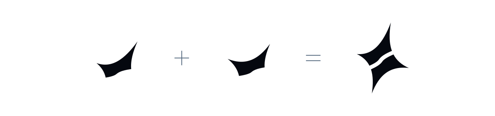
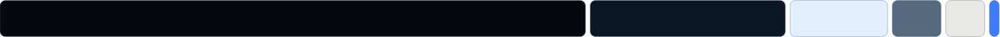
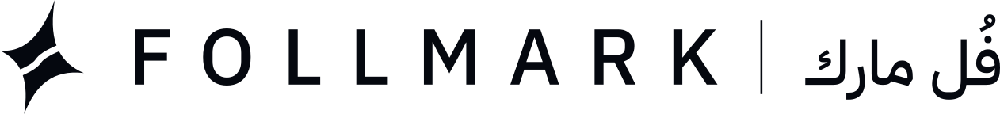

  

<h3 align="center" dir="rtl">الفُل مارك مش حظ.</h3>

Full marks aren't luck.

 

فُل مارك منصّة تعليم للمدرّسين في مصر. كل مدرّس موقعه باسمه، وفُل مارك بيمضي تحت.

Follmark is the learning platform for teachers in Egypt. Every teacher's site carries their own name. Follmark signs at the bottom.

 

<h3 align="center">الفكرة · The idea</h3>

  <picture>
    <source media="(prefers-color-scheme: dark)" srcset="assets/idea-dark.svg">
    
  </picture>

صح + صح = فُل مارك

Egyptian teachers draw a star on a full-mark paper. Ours is two of their ticks, one turned around, locked together.

 

<h3 align="center">الألوان · Colour</h3>

  

Mostly night. Ice for the logo. Signal blue only on buttons.

<table align="center">
  <tr><td></td><td>Night</td><td><code>#05080F</code></td><td>Main background</td></tr>
  <tr><td></td><td>Midnight</td><td><code>#0C1726</code></td><td>Cards and panels</td></tr>
  <tr><td></td><td>Steel</td><td><code>#55697F</code></td><td>Secondary text, lines</td></tr>
  <tr><td></td><td>Ice</td><td><code>#E3EEFF</code></td><td>Logo and text on dark</td></tr>
  <tr><td></td><td>Bone</td><td><code>#E8E8E4</code></td><td>Light backgrounds and print</td></tr>
  <tr><td></td><td>Signal</td><td><code>#3D7BFF</code></td><td>Buttons and links only</td></tr>
</table>

 

<h3 align="center">الخط · Type</h3>

العربي دايمًا الأول. خط واحد للعنوان والنص.

IBM Plex Sans Arabic and IBM Plex Sans. The wordmark is capitals, Medium, spaced 0.34em. Arabic is never letter-spaced.

 

<h3 align="center">الصوت · Voice</h3>

Talk like a good teacher: short, warm, Egyptian.

<table align="center" dir="rtl">
  <tr><th>اكتب كده</th><th>مش كده</th></tr>
  <tr>
    <td>خلصت الباب؟ امتحن نفسك في ٥ دقايق. ٨ من ١٠. فاضل سؤالين على الفُل مارك.</td>
    <td>عزيزي الطالب، يرجى إكمال الاختبار الخاص بالوحدة الثالثة.</td>
  </tr>
</table>

 
 

  <picture>
    <source media="(prefers-color-scheme: dark)" srcset="assets/lockup-ice.svg">
    
  </picture>

معمول في مصر · Made in Egypt

